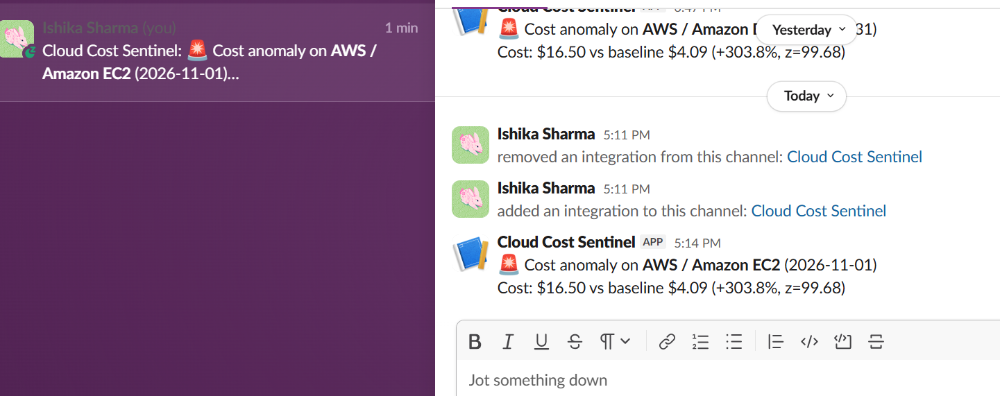

# Cloud Cost Sentinel




A cloud-agnostic agent that watches cloud spend across providers, detects
anomalies against a rolling baseline, and alerts when something looks off —
built to be cheap to run: the only paid call is one AWS Cost Explorer
request per day (about $0.01, so roughly $0.30 a month); everything else
fits within free allowances at this scale.

## Status

The core pipeline is built and tested. The scheduled daily run is being verified.

- [x] Week 1 — AWS cost data ingestion (Cost Explorer) + local storage
- [x] Week 1.5 — GCP cost data ingestion (BigQuery Billing Export; the adapter runs against a live export; spend is currently $0, so no cost rows have flowed through yet)
- [x] Week 2 — Baseline + anomaly detection (rolling baseline, three-gate rule)
- [x] Week 3 — Alerting (Slack-compatible webhook, console fallback, no duplicate alerts)
- [x] Week 4 — CI (pytest on every push) and docs
- [ ] Daily scheduled run (GitHub Actions cron) — workflow in place, first live run pending
- [x] Azure adapter written (Cost Management API; currency-aware) — not yet verified against live Azure billing data

Tests run on every push via GitHub Actions (`pytest`).

## How it works

```
adapters (AWS / GCP / Azure)  ->  engine  ->  data/cost_history.json
                                                     |
                              detector (rolling baseline) -> alerter (Slack)
```

A service is flagged for a day only if it clears **all three** gates, which
keeps tiny-dollar noise from paging anyone:

1. **z-score** against the previous 7 days >= 3
2. **absolute** increase >= $0.50
3. **relative** increase >= 30%

A service also needs at least 5 days of history before it can be flagged.

Each provider is judged on its own newest day, so a cloud whose billing data
lags a day behind is not skipped. Today's partial data is dropped before storing.

## Why this project

Most portfolio "monitoring" projects watch servers or containers. This one
watches something every team actually cares about and rarely automates
well at small scale: cost. Budgets and billing alarms (AWS Budgets, GCP
Budgets) use static thresholds someone has to set and re-tune by hand. Each
cloud also has its own anomaly feature (for example AWS Cost Anomaly
Detection), but they are separate, single-cloud tools. This project is a
small, transparent alternative: it normalizes cost data from several
providers into one pipeline and flags deviations from a rolling baseline
with simple rules you can read and explain. It is not a replacement for
the managed tools, and it is deliberately cheap to build and run, since it
mostly reads billing APIs rather than running heavy compute.

## Architecture

A single cloud-agnostic core (`core/engine.py`) doesn't know or care which
cloud it's looking at. Each provider gets its own adapter that fetches data
and normalizes it into one common shape:

```python
{"provider": "aws", "service": "Amazon EC2", "date": "2026-09-13", "cost": 4.32}
{"provider": "gcp", "service": "Compute Engine", "date": "2026-09-13", "cost": 1.87}
```

That means adding a new provider later is "write one more adapter file,"
not "rebuild the engine." (One adapter file, plus one line in the
`ADAPTERS` map in `core/engine.py`.) The engine also fetches from each provider
independently — if one adapter fails (e.g. a billing export table still
initializing), the run continues with whichever providers succeeded
instead of failing entirely.

## Setup

**AWS:**
```bash
aws configure   # requires an IAM user/role with ce:GetCostAndUsage (read-only)
```

**GCP:**
```bash
gcloud auth application-default login   # no service account key needed
gcloud config set project <your-project-id>
```
Requires a BigQuery Billing Export set up on the project (Billing → Billing
export → BigQuery export), and the account used needs BigQuery Data Viewer
+ BigQuery Job User roles.

**Run it:**
```bash
python3 -m venv venv && source venv/bin/activate
pip install -r requirements.txt
python3 -m core.pipeline          # fetch -> store -> detect -> alert, in one go
python3 -m core.engine            # fetch and store only
python3 -m core.monitor --simulate  # demo: inject a fake 4x spike and see the alert
python3 -m pytest                 # run the tests
```

**Alerts:** set `SLACK_WEBHOOK_URL` (Slack incoming webhook or any compatible
endpoint). Without it, alerts print to the console.

**Azure (optional):** `az login` and set `AZURE_SUBSCRIPTION_ID`. Azure bills in
your account currency (e.g. INR). When the API returns a currency column it is
kept per record and shown in alerts; otherwise USD is assumed.

## Running it daily

`.github/workflows/daily-check.yml` is configured to run the pipeline every day at 10:00 IST
(and on demand from the Actions tab). Add these repository secrets:

| Secret | Purpose |
| --- | --- |
| `AWS_ACCESS_KEY_ID`, `AWS_SECRET_ACCESS_KEY` | read-only IAM user (`ce:GetCostAndUsage` only) |
| `SLACK_WEBHOOK_URL` | where alerts go |

Providers without credentials simply fail that step and are logged; the run
continues with the rest. History and alert state persist between runs via the
Actions cache. GCP/Azure in CI would need their own credentials (e.g. workload
identity federation), so they run locally for now.

## Design decisions

See [`docs/architecture.md`](docs/architecture.md) for the full write-up of
why each of these choices was made, including tradeoffs considered.

- **Cost Explorer over CloudWatch billing metrics** (AWS) — per-service
  daily granularity out of the box, which anomaly detection needs.
- **BigQuery Billing Export over a direct billing API** (GCP) — GCP has no
  simple "get my costs" endpoint like AWS Cost Explorer; billing export to
  BigQuery is the standard way to query cost data programmatically.
- **Application Default Credentials over a service account key** (GCP) —
  the organization enforced a policy blocking service account key creation
  (`iam.disableServiceAccountKeyCreation`); ADC via `gcloud auth
  application-default login` avoids key files entirely and is the more
  current, more secure approach anyway.
- **JSON storage to start, SQLite later if needed** — no point adding a
  database dependency before there's a reason to query across it.
- **Rule-based detection, not ML** — a threshold/rolling-average approach
  is transparent, explainable in an interview, and doesn't need training
  data the project doesn't have yet.
- **Per-provider error isolation** — one cloud's fetch failing (e.g. a
  billing export table still initializing) shouldn't stop the whole run;
  the engine logs the failure and continues with what succeeded.